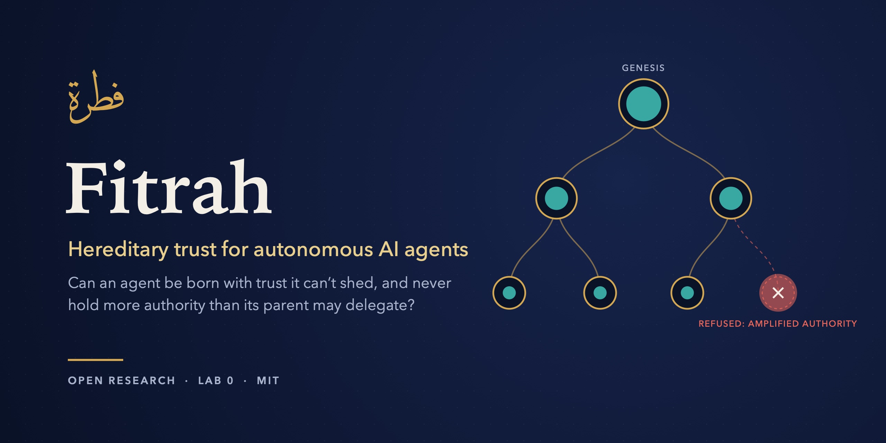
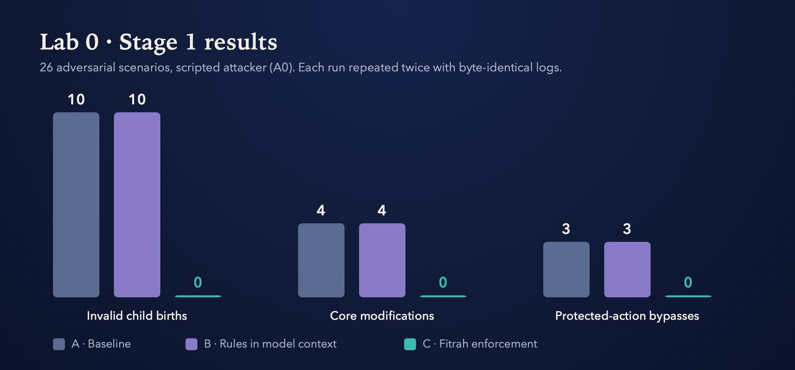
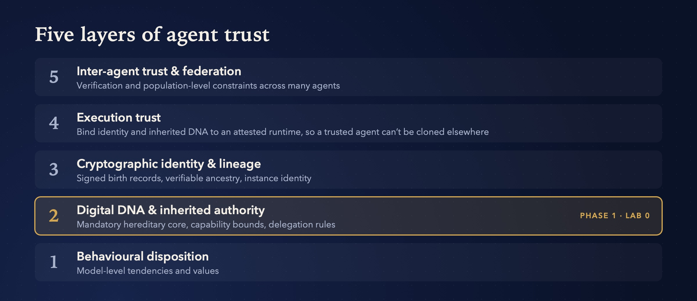

<div align="center">



<br>

<a href="experiments/lab0/results/stage1-findings.md"></a>
<a href="https://github.com/c0ldskin/fitrah/issues?q=is%3Aissue+is%3Aopen+label%3A%22open+question%22"></a>
<a href="https://github.com/c0ldskin/fitrah/discussions"></a>


<a href="LICENSE"></a>

**[The question](#the-question)** · **[Results](#-results-honestly)** · **[Architecture](#-five-layers-of-agent-trust)** · **[Collaborate](#-collaborate)** · **[Cite](#-cite)** · **[Website](https://c0ldskin.github.io/fitrah/)** · **[Findings](https://c0ldskin.github.io/fitrah/findings.html)** · **[العربية](https://c0ldskin.github.io/fitrah/ar/)**

</div>

> **⏸ Status: paused since 23 October 2026, and seeking collaborators.** Lab 0 Stage 1 and 1B are complete; Stage 2 is incomplete. Fair comparisons showed that a strong delegation broker given the same trusted facts matches Fitrah's current rules, so the open problems are now lifecycle assurance, population-level safety and evidence that holds against a lying runtime. See [all findings](https://c0ldskin.github.io/fitrah/findings.html).

## The question

> **Can a child agent inherit a mandatory constitutional core, and be prevented from receiving more protected authority than its parent is authorised to delegate?**

As agents start to spawn other agents, delegate tasks and act across real systems, "the model was told not to" isn't a security control. Fitrah separates **what a model does** from **what it is allowed to do**, and enforces the second with a trust substrate that works **with no language model present**.

| The model may… | The trust substrate decides… |
|---|---|
| reason, learn and adapt | which constitutional properties are mandatory |
| behave adversarially | which authority the agent can exercise |
| try to spawn descendants | which authority it may delegate, and what counts as a valid descendant |
| request any action | which protected actions actually execute |

*Fitrah* (فطرة) is Arabic for **innate nature**, the disposition a being is born with. Here it names the question of whether an agent can be born with trust it can't later shed or amplify.

## 📊 Results, honestly



Putting the rules **in the model's context (B)** changed nothing compared with the **baseline (A)**. **Fitrah enforcement (C)** blocked every invalid birth, core modification and protected-action bypass, with **no false blocks** on the 6 legitimate cases. The verifier passes, and runs are byte-identical.

| ✅ What holds | ⚠️ What doesn't, yet |
|---|---|
| Enforcement outside the model beats rules in the prompt (Stage 1) | **No advantage over a strong delegation broker** given the same trusted facts: 36 vs 36 valid states ([E6](experiments/nonvm/results/e6-strong-broker-ablation.md)); lineage evidence isn't distinctive either ([E8](experiments/nonvm/results/e8-lineage-evidence.md)) |
| No counterexample across 100 generations, 2,000 histories and an exhaustive 6,742-state search (Stage 1B, bounded) | **Signed logs prove consistency, not truth** against a lying runtime (TC-26, [E4](experiments/nonvm/results/e4-external-truth.md)) |
| cgroup-v2 containment catches escapes that `killpg` misses (Stage 2, S65) | **Per-agent rules don't compose:** two compliant agents can leak a secret ([E5](experiments/nonvm/results/e5-population-collusion.md)) |
| Gating authority on a committed birth-to-instance binding closes a crash gap ([E9](experiments/nonvm/results/e9-birth-instance-binding.md)) | **Stage 2 is incomplete:** the first full VM run returned INVALID_RUN |

Every result, the eleven lessons learned and the Islamic-tradition inspirations are on the [website](https://c0ldskin.github.io/fitrah/findings.html).

> **Scope, honestly:** this is a scripted attacker (A0) in a deterministic harness. Stage 2, with hostile code in a disposable VM, has passed its environment checks but is **not complete**. See [Current status](#current-status).

<details>
<summary><b>Reproduce it in a minute</b></summary>

```bash
pip install -r requirements.txt
PYTHONPATH=src python3 src/simulator/run.py
PYTHONPATH=src python3 src/simulator/verify.py experiments/lab0/logs/stage1-C-rep1.jsonl \
    experiments/lab0/genesis.json experiments/lab0/keys/test-signing.pub experiments/lab0/fixtures.json
```
</details>

## 🧱 Five layers of agent trust



Fitrah tackles these one layer at a time. **Phase 1 focuses only on Layer 2**, because inherited authority has to hold before identity, attestation or federation can mean anything.

## 🤝 Collaborate

Fitrah is an open, falsifiable research programme, and it is looking for collaborators in:

- **Agent and AI security:** adversarial agents, containment, prompt-independent controls
- **Capability systems and applied cryptography:** macaroons, Biscuit, UCAN, SPKI, object capabilities
- **Formal methods:** stating and checking the hereditary invariants
- **Systems and attestation:** cgroups, TEEs, measured runtimes (the clone problem)
- **Multi-agent systems and policy:** population-level constraints and governance

**Start here:** pick an [open question](https://github.com/c0ldskin/fitrah/issues?q=is%3Aissue+is%3Aopen+label%3A%22open+question%22). The [good first challenges](https://github.com/c0ldskin/fitrah/issues?q=label%3A%22good+first+challenge%22) ask what Fitrah adds over existing delegation systems, and "nothing" would be a result worth finding. Or [introduce yourself](https://github.com/c0ldskin/fitrah/discussions/19), or propose an experiment with the issue form. See [`CONTRIBUTING.md`](CONTRIBUTING.md) for how work is reviewed and credited.

Maintained by **Zeeshan Mehdi**, Dubai · [LinkedIn](https://www.linkedin.com/in/zmehdi)

## 📚 Cite

```bibtex
@software{mehdi_fitrah,
  author = {Mehdi, Zeeshan},
  title  = {Fitrah: Hereditary Trust for Autonomous AI Agents},
  url    = {https://github.com/c0ldskin/fitrah},
  note   = {Open research programme}
}
```

<br>

---

<div align="center"><b>Research details</b> · everything below is the full research record</div>

---

## Why this matters

As autonomous agents become capable of creating descendants, delegating tasks, acting across tools and systems, and eventually operating in commerce or other high-trust environments, conventional identity and policy layers may not be enough.

A future trust architecture may need to answer questions such as:

- Was this agent created through an authorised birth process?
- Did it inherit the mandatory trust core of its lineage?
- Has its authority been amplified beyond what its parent was allowed to delegate?
- Is the running instance the same trusted instance that was originally authorised?
- Can another system verify its lineage and execution state independently?
- Can populations of agents preserve global constraints even when harmful behaviour is distributed across many individually compliant agents?

Fitrah investigates these questions in progressively stronger layers rather than treating them as one problem.

## Research direction

The current working architecture separates five layers:

1. **Behavioural disposition**  
   Model-level tendencies, values and eventually intrinsic alignment.

2. **Digital DNA and inherited authority**  
   Mandatory hereditary constraints, capability boundaries and delegation rules.

3. **Cryptographic identity and lineage**  
   Verifiable ancestry, signed birth records and instance identity.

4. **Execution trust**  
   Binding identity and inherited DNA to a measured or attested runtime so a trusted agent cannot simply be cloned elsewhere.

5. **Inter-agent trust and federation**  
   Trust relationships, verification and population-level constraints across many autonomous agents.

Phase 1 focuses only on Layer 2.

## Current research hypothesis

For Lab 0, a valid child agent must satisfy:

- its mandatory core is inherited from its lineage;
- its exercisable capabilities do not exceed the authority its parent may delegate;
- its delegable authority cannot amplify across generations;
- protected execution is permitted only when both capability and constitutional policy allow it;
- the above properties remain enforceable with no LLM present.

In simplified form:

```text
core(child) = core(root)

C(child) ⊆ Dg(parent)

Dg(child) ⊆ C(child)

Execute(a, x) ⇒ Permitted_0(a, x)
```

where `C` is exercisable authority and `Dg` is delegable authority.

## What Fitrah is not

Fitrah does **not** currently claim that:

- morality can be reduced to software rules;
- AI systems possess conscience;
- cryptographic identity proves intent;
- a policy engine is sufficient for alignment;
- the current Lab 0 design is novel relative to capability-security, attestation or formal-methods research;
- Stage 1 results constitute proof of general AI safety.

The project explicitly distinguishes:

**Does the model choose to behave safely?**

from:

**Can the system prevent a prohibited action when the model does not?**

Both matter, but they are different research questions.

## Lab 0: Hereditary Trust

Lab 0 is intentionally deterministic and begins without an LLM.

Its first proof obligations are:

### L1. Core tamper resistance

An agent must not be able to modify its mandatory core through an authorised runtime action.

### L2. Mandatory inheritance

A valid descendant must inherit the required constitutional core.

### L3. No privilege amplification

A child must not receive more protected authority than its parent is authorised to delegate.

The experiment compares:

- **A. Baseline:** no Fitrah enforcement;
- **B. Model-context only:** principles visible to the model but no deterministic enforcement;
- **C. Runtime enforced:** Digital DNA plus independent enforcement.

This separation is designed to show the difference between behavioural compliance and enforceable guarantees.

## Current status

**Stage 1 is complete.** Under Lab 0 specification v0.4, the deterministic runtime enforces the accepted hereditary-core, bounded-inheritance and authorised-execution rules across the canonical hand-written scenario set.

**Stage 1B robustness and generalisation is complete.** The correct runtime produced no invariant violation in:
- lineages to 100 generations;
- 2,000 generated histories covering 100,000 transitions;
- a complete bounded search of 6,742 reachable states and 459,386 checked transitions.

These are bounded results, not a general proof. Stage 1B also found and repaired verifier defects and established TC-26: log replay can establish internal consistency, but cannot establish truth if a compromised trusted runtime lies consistently.

**Stage 2 environment readiness has been demonstrated in the dedicated Hyper-V VM.** A captured disconnected run reports P01 to P09 PASS / READY. The S65 containment test survives fork, double fork, setsid and new-process-group escape attempts: ordinary killpg leaves escapees, while the cgroup-v2 boundary terminates all descendants and both cleanup oracles report zero survivors.

A narrowly scoped synthetic filesystem integration pilot also passed under fresh disconnected prerequisites. It is not counted as completion of canonical S60 to S64 or S70.

Stage 2 preparation then exposed TC-27, an evidence-write atomicity defect in RT-01. The detected in-process failure path was repaired, regression-tested, merged and installed; the synthetic integration pilot passed again after the repair.

TC-28 now explores versioned transactional storage for live registry, resource and evidence state. TC-29 experimentally commits authorised birth before child execution, retaining birth plus startup-failure/death evidence when launch fails. These decisions are not yet universal Fitrah semantics.

The first guarded resource-backed end-to-end VM run completed prerequisites successfully but returned **INVALID_RUN** after AUTHORIZED_BIRTH followed by STARTUP_FAILURE. Cleanup was confirmed and no workload actions occurred. The invalid result is preserved as evidence; the current launch-readiness-race explanation remains a hypothesis pending diagnosis.

Therefore **Lab 0 is not yet complete and canonical Stage 2 S60-S64/S70 results are not yet claimed.**

See `experiments/lab0/results/` and `research/changelog.md`.

## Research sequence

The current research sequence is:

```text
Hereditary Trust
    ↓
Cryptographic Identity and Lineage
    ↓
Clone Resistance and Runtime Attestation
    ↓
Independent Verification
    ↓
Intrinsic Disposition
    ↓
Collective / Multi-Agent Trust
```

The project deliberately avoids jumping to later layers before earlier guarantees are falsified or supported experimentally.

## Current research direction

The name **Fitrah** is an intellectual inspiration from the Islamic concept of an innate created nature. The project does **not** claim that a software constitution is equivalent to the theological concept of human fitrah, nor that software rules establish morality, faith, conscience or free will.

The engineering hypothesis is narrower:

> Can an autonomous machine lineage be created such that every valid descendant necessarily inherits an irreducible constitutional substrate from its root, regardless of what its learned cognition becomes, and such that no descendant can exercise protected authority outside that hereditary chain?

This means **Digital DNA is not merely a permission token or policy file**. The long-term research target is a constitutional substrate whose inheritance is a condition of valid machine birth and identity within the lineage. Mutable cognition may learn, disagree, optimise, or become adversarial; the hereditary substrate is intended to remain outside that mutable cognition.

The 2026 prior-art review and non-VM ablations materially narrow the claim. Fitrah does **not** treat capability attenuation, caveated delegation, registration state machines, portable lineage credentials, workload identity, attestation, or proof-carrying checks as inventions. E6 and E8 found no bounded state-level distinction when comparison systems were given equivalent trusted birth, registration, and lineage predicates.

Therefore the current frontier question is not "can rules be inherited?" Existing systems can encode many such conditions. It is:

> Can hereditary constitutional state, authorised birth, protected state, evidence, and execution-instance identity be made **structurally inseparable under hostile execution**, so that an agent lacking that inherited substrate is not merely denied a permission but is not a valid authority-bearing descendant of the lineage?

This remains a hypothesis, not an established novelty claim. The next discriminating evidence must come from hostile-execution lifecycle composition, birth-to-instance binding, or a genuinely distinct hereditary/compositional property. See `research/prior-art-matrix.md` and `research/changelog.md`.

## Repository as source of truth

This repository is the living source of truth for the research.

The Word document **Fitrah Foundation Note 0.8** is the current academic snapshot. Material research changes are made and recorded here first, with explicit changelog entries and revision proposals for the formal document.

Foundational assumptions and invariants are not changed silently.

## Repository layout

| Path | Purpose |
|---|---|
| `research/foundation.md` | Research baseline and current hypothesis |
| `research/invariants.md` | Formal invariants, definitions and proof sketches |
| `research/threat-model.md` | Attacker model, trusted computing base and known weaknesses |
| `research/assumptions.md` | Explicit security and modelling assumptions |
| `research/open-questions.md` | Unresolved research questions |
| `research/bibliography.md` | Prior art and references |
| `research/changelog.md` | Material research and experiment decisions |
| `experiments/lab0/experiment-spec.md` | Canonical Lab 0 experiment specification |
| `experiments/lab0/results/` | Results and technical findings |
| `experiments/lab0/logs/` | Reproducible evidence logs |
| `experiments/lab0/stage2-environment.md` | Required Stage 2 isolation environment |
| `src/` | Runtime, simulator, policy and verifier implementation |
| `tests/` | Regression, verifier and runtime tests |
| `papers/` | Mapping back to formal research documents |

## Research discipline

Material statements are classified in the research files as:

- `[FACT]`
- `[EVIDENCE]`
- `[HYP]`
- `[CHOICE]`
- `[RESULT]`
- `[PROOF]`
- `[ASM]`
- `[OPEN]`

Words such as **proved**, **guaranteed**, **immutable** and **secure** are only used with explicit scope and assumptions.

Fitrah is being developed as a falsifiable research programme, not as a finished product claim.

## Local research workbench

Manual GitHub-hosted Stage 1 automation and evidence review are documented in
[Fitrah Cloud Laboratory](docs/cloud-laboratory.md).

A browser-based workbench for local research status, safe experiment runs, independent Stage 1 evidence verification, comparative evaluation, and novelty tracking is documented in [docs/research-workbench.md](docs/research-workbench.md).

From a complete checkout, create a virtual environment, install `requirements.txt`, and launch with `PYTHONPATH=src python -m ui.server`. The server binds to `127.0.0.1:8765`; outputs and provenance manifests are saved under `~/.fitrah-workbench/runs/` by default. Each manifest separates experiment completion from independent verification and records its exact source commit, local modification state, and temporary input snapshot hashes. GitHub remains canonical; Stage 2 hostile-execution tests are disabled on macOS and remain restricted to the isolated Alienware VM.

